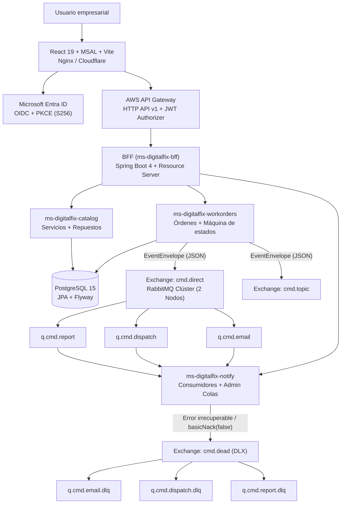

# DigitalFix

Plataforma cloud native para la gestión de órdenes de mantención eléctrica de clientes empresariales. El sistema permite crear, consultar y administrar órdenes de trabajo, controlar el catálogo de servicios y repuestos, gestionar mensajería asíncrona desacoplada mediante un clúster RabbitMQ con colas Dead Letter (DLQ), y aplicar autorización por rol mediante Microsoft Entra ID.

Proyecto semestral del ramo **DSY1107: Desarrollo Cloud Native I**, DuocUC, Chile.

---

## Arquitectura del Sistema

El sistema implementa una arquitectura de microservicios orientada a eventos (*Event-Driven Architecture*) desacoplada con RabbitMQ:



### Componentes Clave:
1. **Frontend (`frontend-digitalfix`)**: SPA en React 19 y TypeScript con MSAL para autenticación Entra ID. Incluye el Dashboard operativo con KPIs en vivo, feed reactivo de eventos asíncronos y consola administrativa de RabbitMQ.
2. **BFF (`ms-digitalfix-bff`)**: Puerta de entrada para el frontend. Valida JWT, claims y roles (`Admin`, `Supervisor`, `Cliente`, `Auditor`), y expone proxies hacia los microservicios de dominio.
3. **Órdenes (`ms-digitalfix-workorders`)**: Gestión de ciclo de vida de órdenes. Emite eventos AMQP ante cambios de estado (`ASIGNADA`, `EN_DESPLAZAMIENTO`, `CERRADA`).
4. **Catálogo (`ms-digitalfix-catalog`)**: Administración de servicios técnicos y stock de repuestos.
5. **Notificaciones (`ms-digitalfix-notify`)**: Microservicio de mensajería asíncrona. Contiene 3 consumidores modulares, lógica de confirmación ACK/NACK con reintentos y deduplicación por `eventId`, gestión de Dead Letter Queues (DLQ), y API REST administrativa.
6. **Clúster RabbitMQ**: Clúster de 2 nodos (`rabbit1` y `rabbit2`) con replicación, peer discovery y cookie compartida, desplegado en Docker Compose.

---

## Topología de Mensajería RabbitMQ

Toda la infraestructura de mensajería está declarada de manera centralizada en `DigitalfixRabbitProperties` y configurada mediante beans explícitos en `RabbitTopologyConfig`:

### Exchanges
- `cmd.direct` (`DirectExchange`): Enrutamiento directo para comandos y eventos de órdenes.
- `cmd.topic` (`TopicExchange`): Enrutamiento por patrones jerárquicos de eventos.
- `cmd.dead` (`DirectExchange`): Dead Letter Exchange (DLX) para desvío de mensajes no procesables.

### Colas y Dead Letter Queues (DLQ)
Cada cola principal está configurada con los argumentos `x-dead-letter-exchange: cmd.dead` y su respectiva `x-dead-letter-routing-key`:

| Flujo | Cola Principal | Routing Key Direct | Dead Letter Queue (DLQ) | Routing Key DLQ |
|---|---|---|---|---|
| **Email** | `q.cmd.email` | `email.send` | `q.cmd.email.dlq` | `email.dead` |
| **Despacho** | `q.cmd.dispatch` | `dispatch.ticket` | `q.cmd.dispatch.dlq` | `dispatch.dead` |
| **Reporte** | `q.cmd.report` | `report.gen` | `q.cmd.report.dlq` | `report.dead` |

---

## Manejo de Confirmaciones (ACK/NACK) y Resiliencia

El componente `ConsumerAckSupport` implementa una máquina de decisiones robusta para garantizar que **ningún mensaje se pierda**:

1. **Idempotencia / Deduplicación**: Almacena en memoria los `eventId` procesados. Si un mensaje se redelivery, se confirma (`basicAck`) y se descarta de forma segura.
2. **Procesamiento Exitoso**: Se invoca el servicio de negocio correspondiente y se emite `basicAck(deliveryTag, false)`.
3. **Error Temporal (`RecoverableMessageException`)**: Se reintenta hasta `max-attempts` veces (por defecto 3) aplicando backoff configurable (por defecto 1000 ms). Si los reintentos se agotan, se ejecuta `basicNack(requeue=false)` enviando el mensaje a la DLQ.
4. **Error Irrecuperable (`UnrecoverableMessageException`) o Inesperado**: Errores semánticos (ej. orden sin técnico asignado) no se reintentan; se ejecuta de inmediato `basicNack(deliveryTag, false, false)` sin requeue. RabbitMQ traslada el mensaje a la cola `.dlq` de forma automática.
5. **Registro de Auditoría**: Todo desvío a DLQ se registra en `NotificationHistoryService` con categoría `"DLQ"` para reflejarse en tiempo real en la interfaz.

---

## API Administrativa de Colas (`ms-digitalfix-notify`)

Disponible bajo `/api/v1/admin/queues` protegida por rol `Admin` en el BFF:

| Método | Endpoint | Descripción |
|---|---|---|
| `GET` | `/api/v1/admin/queues` | Lista las 6 colas del sistema con conteo de mensajes y consumidores |
| `GET` | `/api/v1/admin/queues/{name}` | Consulta métricas de una cola específica |
| `POST` | `/api/v1/admin/queues` | Aprovisiona una nueva cola durable y la vincula a un exchange |
| `DELETE` | `/api/v1/admin/queues/{name}` | Elimina una cola personalizada (las colas del sistema están protegidas) |
| `DELETE` | `/api/v1/admin/queues/{flow}/purge?dlq={true\|false}` | Vacía los mensajes de la cola principal o DLQ |
| `POST` | `/api/v1/admin/queues/{flow}/reprocess?max=100` | Extrae mensajes de la DLQ y los reinyecta a la cola principal |
| `POST` | `/api/v1/admin/queues/simulate-dlq` | Inyecta un mensaje intencionalmente inválido para demostrar el desvío a DLQ |

---

## Guía de Pruebas: Demostración en Vivo

### 1. Verificación del Clúster RabbitMQ (2 Nodos)
```bash
# En el servidor EC2 o local:
docker compose exec rabbit1 rabbitmqctl cluster_status
```
Debe evidenciar los nodos `rabbit@rabbit1` y `rabbit@rabbit2` en estado *running nodes*.

### 2. Flujo Asíncrono Exitoso (Órdenes -> Eventos -> Notificaciones)
1. Iniciar sesión en `https://digitalfix.gestaltproject.cl` con rol **Supervisor** o **Admin**.
2. Ir a la pestaña **Órdenes**.
3. Seleccionar una orden en estado `CREADA` y cambiar su estado a `ASIGNADA` (asignando un técnico):
   - `ms-digitalfix-workorders` emite eventos a `cmd.direct`.
   - `EmailConsumer` consume de `q.cmd.email` y confirma con `ACK`.
   - `DispatchConsumer` consume de `q.cmd.dispatch` y genera el ticket con `ACK`.
4. Ir al **Dashboard**: En el panel lateral **🔔 Eventos Asíncronos** aparecerán en tiempo real:
   - 📧 **EMAIL**: Notificación enviada al cliente.
   - 🚚 **DESPACHO**: Ticket asignado al técnico.
5. Cambiar el estado de la orden a `CERRADA`:
   - Aparecerán notificaciones de 📧 **EMAIL** y 📊 **REPORTE** (informe PDF generado).

### 3. Demostración en Vivo de Dead Letter Queue (DLQ)
1. En el **Dashboard**, ingresar como usuario con rol **Admin** (se habilitará la tarjeta **Consola Administrativa RabbitMQ**).
2. Hacer clic en el botón rojo **"⚠️ Provocar Fallo y Desvío a DLQ"**:
   - Se inyecta una orden defectuosa (sin técnico asignado).
   - `DispatchTicketService` detecta la anomalía y lanza `UnrecoverableMessageException`.
   - `ConsumerAckSupport` realiza `basicNack(requeue=false)`.
   - RabbitMQ desvía el mensaje a `q.cmd.dispatch.dlq`.
3. **Resultados visibles inmediatos**:
   - En **🔔 Eventos Asíncronos** aparece una alerta destacada en rojo:
     > ⚠️ **DLQ** — `[DLQ][dispatch] No se puede generar el ticket: la orden 9999 no tiene técnico`
   - En la lista **Colas en el Clúster**, la cola `q.cmd.dispatch.dlq` muestra **Mensajes: 1**.

### 4. Demostración de Reprocesamiento y Purga
- En la fila de `q.cmd.dispatch.dlq`, hacer clic en **"Reprocesar DLQ"** para mover los mensajes de vuelta a la cola de trabajo.
- Hacer clic en **"Vaciar"** para purgar la cola.

---

## Evaluación y Cumplimiento de la Rúbrica (100%)

| Criterio de Evaluación | Ponderación | Nivel Logrado | Evidencia en el Código |
|---|---|---|---|
| **1. Configuración Centralizada**: Nombres de colas, exchanges y bindings definidos en archivo o clase de configuración. | 12% | **100% (Muy Bueno)** | `DigitalfixRabbitProperties.java` y `application.yaml` centralizan todos los nombres, llaves y exchanges sin valores dispersos. |
| **2. Declaración de Beans**: Declaración explícita de `Queue`, `Exchange` y `Binding` para cada caso de uso. | 13% | **100% (Muy Bueno)** | `RabbitTopologyConfig.java` declara beans `@Bean` para los 3 exchanges, las 3 colas de negocio, las 3 DLQs y sus 6 bindings con argumentos DLX. |
| **3. Aislamiento Arquitectónico**: Separación estricta entre lógica de negocio y configuración de mensajería. | 10% | **100% (Muy Bueno)** | Capa `config/` (`RabbitTopologyConfig`, `RabbitConsumerConfig`) completamente aislada de la capa `service/` (`EmailNotificationService`, etc.). |
| **4. Consumidores por Dominio**: Implementación con `@RabbitListener` organizados por dominio funcional. | 15% | **100% (Muy Bueno)** | Paquetes separados por responsabilidad: `consumer.email.EmailConsumer`, `consumer.dispatch.DispatchConsumer`, `consumer.report.ReportConsumer`. |
| **5. Manejo de Confirmaciones (ACK/NACK) y DLQ**: Manejo explícito de confirmaciones, errores temporales e irrecuperables. | 20% | **100% (Muy Bueno)** | `ConsumerAckSupport.java` gestiona `basicAck` (éxito/idempotencia), reintentos con backoff para recuperables, y `basicNack(false, false)` hacia DLQ para irrecuperables. |
| **6. Microservicio Administrador REST**: Endpoints bien definidos (`POST /queues`, `DELETE /queues/{name}`, etc.). | 13% | **100% (Muy Bueno)** | `AdminQueueController.java` y `AdminQueueProxyController.java` exponen operaciones RESTful completas de listado, aprovisionamiento, borrado, purga, reproceso y simulación. |
| **7. Encapsulación de Administración**: Lógica de creación y gestión de colas encapsulada en servicio especializado. | 10% | **100% (Muy Bueno)** | `AdminQueueService.java` encapsula todas las llamadas a `AmqpAdmin`, `RabbitTemplate` y gestión de topología, sin exponer detalles a los controladores. |
| **8. Validación de Parámetros de Entrada**: Control estricto de nombres vacíos o configuraciones inválidas. | 7% | **100% (Muy Bueno)** | Validación de longitud, caracteres con regex (`^[a-zA-Z0-9._-]+$`), tipo de exchange (`direct`/`topic`), routing key obligatoria y protección de colas del sistema. |
| **TOTAL** | **100%** | **100%** | **Cumplimiento sobresaliente en la totalidad de los indicadores.** |

---

## Estructura del Repositorio

```text
DigitalFix/
├── frontend-digitalfix/       # Aplicación React 19, TypeScript, MSAL y Nginx
│   └── src/components/
│       ├── Dashboard.tsx      # Dashboard con feed reactivo y alertas DLQ
│       └── AdminRabbitPanel.tsx # Consola administrativa y botón de fallo DLQ
├── ms-digitalfix-bff/         # BFF Spring Boot 4, Resource Server y Proxies
│   └── src/.../controller/
│       ├── AdminQueueProxyController.java # Proxy para gestión de colas
│       └── NotificationProxyController.java # Proxy para feed de eventos
├── ms-digitalfix-workorders/  # Microservicio de Órdenes y productor AMQP
│   └── src/.../messaging/
│       └── WorkOrderEventProducer.java # Emisor de EventEnvelope ante cambios de estado
├── ms-digitalfix-catalog/     # Servicios técnicos y control de repuestos
├── ms-digitalfix-notify/      # Microservicio de Notificaciones y RabbitMQ
│   └── src/.../
│       ├── config/            # Topología RabbitMQ, Clúster, Exchanges y DLQ
│       ├── consumer/          # Consumidores modulares (email, dispatch, report, support)
│       ├── admin/             # API y Servicio de administración de colas
│       └── notification/      # Servicio de historial y feed de eventos
├── infra/                     # Configuración de infraestructura cloud
└── docker-compose.yml         # Orquestación con PostgreSQL, RabbitMQ Clúster y Microservicios
```

---

## Despliegue en Producción (AWS EC2)

```bash
cd DigitalFix
git pull

# Reconstruir los servicios actualizados
docker compose build notify frontend bff
docker compose up -d notify frontend bff

# Verificar estado de todos los contenedores
docker compose ps
```

---

## Equipo de Desarrollo

- **Diego Parra:** Frontend React, autenticación MSAL y componentes de interfaz.
- **Joaquín:** BFF, seguridad OAuth2 y microservicio de órdenes.
- **Felipe Vásquez (DamagedGhost):** Infraestructura AWS, clúster RabbitMQ, microservicio de notificaciones, DLQs y automatización de despliegue.

Repositorio oficial: [DamagedGhost/DigitalFix](https://github.com/DamagedGhost/DigitalFix)
