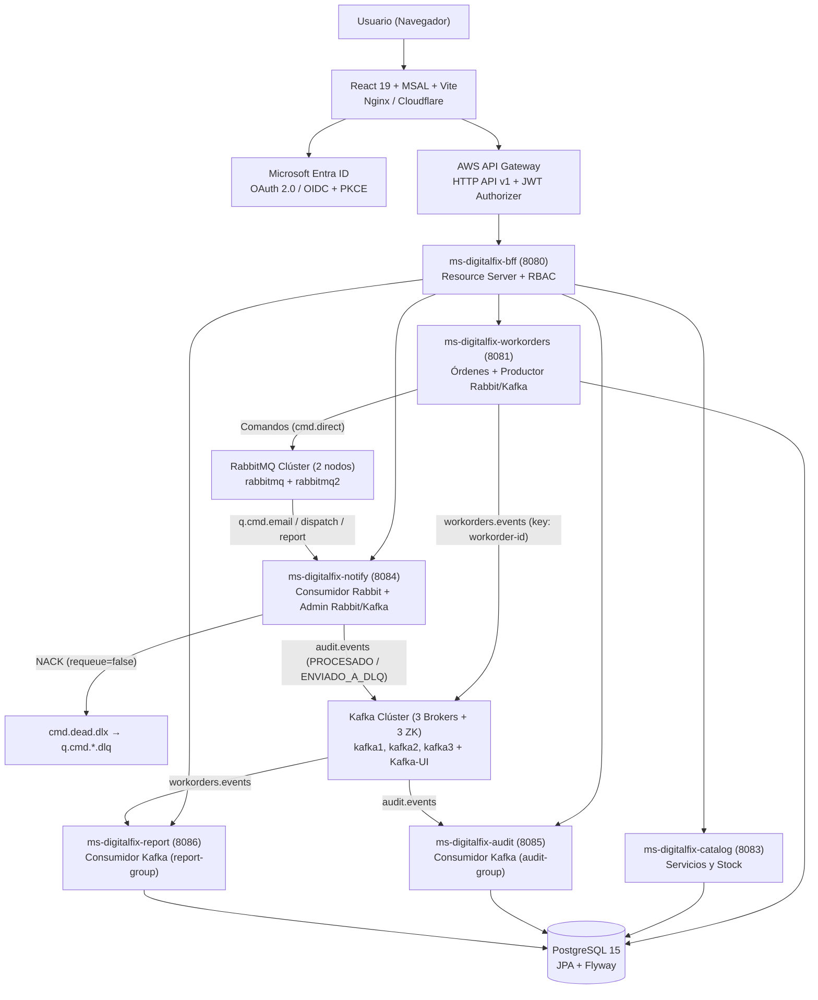

# DigitalFix

Plataforma de microservicios para gestionar órdenes de mantención eléctrica de clientes empresariales. Permite crear y hacer seguimiento de órdenes de trabajo, administrar el catálogo de servicios y repuestos, procesar notificaciones asíncronas con RabbitMQ y analizar eventos en tiempo real (auditoría y reportería) con Apache Kafka, todo protegido con autenticación y roles de Microsoft Entra ID.

Proyecto semestral de **DSY1107: Desarrollo Cloud Native I**, DuocUC.

---

## Arquitectura general

El sistema separa las tareas puntuales (RabbitMQ) del streaming de eventos (Kafka) para que los microservicios no queden acoplados entre sí:

* **RabbitMQ** maneja comandos que deben ejecutarse una vez y desaparecer de la cola al confirmarse (`ACK`): avisos por correo, tickets de despacho y generación de informes de cierre.
* **Apache Kafka** mantiene un log persistente de hechos que ocurrieron en el sistema (`workorders.events` y `audit.events`) para que servicios independientes calculen métricas en vivo (`ms-digitalfix-report`) y guarden un historial de auditoría (`ms-digitalfix-audit`) sin afectar a `ms-digitalfix-workorders` ni a RabbitMQ.



### Servicios del proyecto

1. **`frontend-digitalfix` (puerto `80`)**: SPA en React 19, TypeScript y Tailwind servida con Nginx. Usa MSAL para iniciar sesión con Entra ID y restringe vistas y acciones según el rol (`Admin`, `Supervisor`, `Cliente`, `Auditor`). Incluye Dashboard con eventos asíncronos, Órdenes, Catálogo, Reportería en vivo, Auditoría, Consola RabbitMQ y Consola Kafka.
2. **`ms-digitalfix-bff` (puerto `8080`)**: Único servicio backend expuesto al exterior. Valida el JWT de Entra ID, lee el claim `roles` y aplica `@PreAuthorize` antes de reenviar cada petición a los microservicios internos.
3. **`ms-digitalfix-workorders` (interno `8081`)**: CRUD y máquina de estados de órdenes (`CREADA -> ASIGNADA -> EN_DESPLAZAMIENTO -> EN_EJECUCION -> CERRADA` / `CANCELADA`). Guarda primero en PostgreSQL y luego publica en RabbitMQ y en Kafka (`workorders.events`); si alguno de los brokers falla, el cambio en base de datos no se pierde.
4. **`ms-digitalfix-catalog` (interno `8083`)**: Administración de servicios técnicos, tarifas y control de stock.
5. **`ms-digitalfix-notify` (interno `8084`)**:
   * Consume las 3 colas de RabbitMQ con `ACK/NACK` manual, reintentos y DLQ.
   * Actúa como puente hacia Kafka publicando en `audit.events` el resultado de cada mensaje (`PROCESADO` o `ENVIADO_A_DLQ`).
   * Expone las APIs de administración de RabbitMQ (`/api/admin/queues`) y de Kafka (`/api/admin/kafka`).
6. **`ms-digitalfix-audit` (interno `8085`)**: Consume `audit.events` con `@KafkaListener` (`groupId = audit-group`) y guarda el historial inmutable en PostgreSQL (tabla `audit_records`, migraciones aisladas en `flyway_audit_history`).
7. **`ms-digitalfix-report` (interno `8086`)**: Consume `workorders.events` (`groupId = report-group`) y mantiene la tabla `order_snapshots` (migraciones en `flyway_report_history`) para entregar conteos por estado y por técnico al instante sin pegarle a `ms-workorders`.

---

## Arquitectura de mensajería

### 1. Apache Kafka (Streaming, Analítica y Auditoría)

El clúster vive en [infra/kafka/docker-compose.kafka.yml](infra/kafka/docker-compose.kafka.yml) y levanta:
* **3 nodos Zookeeper (`zk1`, `zk2`, `zk3`)**: Número impar para mantener quórum (tolera la caída de 1 nodo sin perder mayoría al elegir líderes).
* **3 brokers Kafka (`kafka1`, `kafka2`, `kafka3`)**: Exponen un listener `INTERNAL` (`29092`) para el tráfico entre contenedores dentro de `digitalfix-net` y un listener `EXTERNAL` (`9092`, `9093`, `9094`) para conexiones locales.
* **`kafka-ui` (puerto `8090`)**: Consola web para inspeccionar brokers, tópicos, mensajes JSON en vivo y el lag de los consumer groups.

Los brokers tienen `KAFKA_AUTO_CREATE_TOPICS_ENABLE=false` para evitar que se creen tópicos por accidente con 1 partición. Los tópicos del sistema se declaran y aprovisionan al arrancar (`KafkaTopologyConfig` en `notify` y `KafkaConsumerConfig` en `audit`/`report`) con parámetros ajustados a cada flujo:

| Tópico | Particiones | Réplicas / min ISR | `cleanup.policy` | Retención (`retention.ms`) | Consumer Group | Uso |
| --- | :---: | :---: | :---: | :---: | --- | --- |
| `workorders.events` | 3 | 3 / 2 | `delete` | 7 días (`604800000`) | `report-group` | Eventos de órdenes para KPIs en vivo |
| `audit.events` | 3 | 3 / 2 | `delete` | 30 días (`2592000000`) | `audit-group` | Trazabilidad inmutable de auditoría |
| `workorders.events.DLT` | 3 | 3 / 2 | `delete` | 14 días (`1209600000`) | — | Mensajes fallidos o corruptos de órdenes |
| `audit.events.DLT` | 3 | 3 / 2 | `delete` | 14 días (`1209600000`) | — | Mensajes fallidos o corruptos de auditoría |

Decisiones clave en productores y consumidores Kafka:
* **Orden por entidad**: `WorkOrderKafkaProducer` envía con `key = "workorder-<id>"` y `AuditKafkaProducer` usa `correlationId`, asegurando que todos los eventos de una misma orden caigan en la misma partición y se lean en orden.
* **Durabilidad e idempotencia**: Los productores usan `acks=all` y `enable.idempotence=true`; no mandan headers de clase Java (`spring.json.add.type.headers=false`) para desacoplar los paquetes de DTOs entre microservicios.
* **Paralelismo y manejo de errores**: `ms-audit` y `ms-report` corren con `concurrency=3` (un hilo por partición), `ENABLE_AUTO_COMMIT=false`, `ErrorHandlingDeserializer` para JSON rotos, y `DefaultErrorHandler` con 3 reintentos cada 1 s (`FixedBackOff`). Si el error persiste o el payload es inválido (`IllegalArgumentException`), `DeadLetterPublishingRecoverer` manda el mensaje a su tópico `.DLT` sin frenar el consumo.

### 2. RabbitMQ (Comandos y Notificaciones)

El clúster de 2 nodos (`rabbitmq` y `rabbitmq2`) usa `classic_config` peer discovery en [infra/rabbitmq/rabbitmq.conf](infra/rabbitmq/rabbitmq.conf) con `RABBITMQ_ERLANG_COOKIE` compartida. La topología está centralizada en `DigitalfixRabbitProperties` y `RabbitTopologyConfig`:

* **Exchanges**: `cmd.direct` (comandos puntuales), `cmd.topic` (enrutamiento por patrón) y `cmd.dead.dlx` (Dead Letter Exchange).
* **Colas**:

| Flujo | Cola principal | Llave `direct` | Llave `topic` | Dead Letter Queue | Llave DLQ |
| --- | --- | --- | --- | --- | --- |
| Email | `q.cmd.email` | `email.send` | `email.*` | `q.cmd.email.dlq` | `email.dlq` |
| Despacho | `q.cmd.dispatch` | `dispatch.ticket` | `dispatch.#` | `q.cmd.dispatch.dlq` | `dispatch.dlq` |
| Reporte PDF | `q.cmd.report` | `report.gen` | `report.*` | `q.cmd.report.dlq` | `report.dlq` |

En `ConsumerAckSupport` el `ACK` es manual (`prefetch: 1`):
* **Repetido (`eventId` ya procesado)**: `basicAck` y se ignora.
* **Éxito**: `basicAck` + registro en feed del Dashboard + publicación en Kafka `audit.events` (`PROCESADO`).
* **Error temporal (`RecoverableMessageException`)**: 3 intentos con `2000 ms` de espera; si persiste, `basicNack(requeue=false)` hacia la DLQ + evento `ENVIADO_A_DLQ` en Kafka.
* **Error sin arreglo (`UnrecoverableMessageException`, ej. orden sin técnico)**: `basicNack(requeue=false)` directo a la DLQ + evento `ENVIADO_A_DLQ` en Kafka.

---

## Endpoints principales (vía BFF `/api/v1`)

| Módulo | Endpoints | Roles permitidos |
| --- | --- | --- |
| **Órdenes** | `GET/POST /api/v1/workorders`, `PUT /api/v1/workorders/{id}/status` | Lectura: todos · Crear: Cliente, Supervisor, Admin · Cambiar estado: Supervisor, Admin |
| **Catálogo** | `GET/POST /api/v1/catalog`, `PUT /api/v1/catalog/{id}` | Lectura: Supervisor, Admin · Crear/Editar: Admin |
| **Notificaciones** | `GET /api/v1/notifications` | Cualquier usuario autenticado |
| **Auditoría (Kafka)** | `GET /api/v1/audit` (`?outcome=`, `?orderId=`) | Admin, Auditor |
| **Reportería (Kafka)** | `GET /api/v1/reports/orders` | Admin, Supervisor |
| **Admin RabbitMQ** | `GET/POST /api/v1/admin/queues`, `DELETE /{name}`, `DELETE /{flow}/purge`, `POST /{flow}/reprocess`, `POST /simulate-dlq` | Solo Admin |
| **Admin Kafka** | `GET/POST /api/v1/admin/kafka/topics`, `GET/PATCH/DELETE /topics/{name}`, `GET /groups`, `GET /groups/{groupId}` | Solo Admin |

---

## Levantamiento con Docker Compose (Local o AWS EC2)

El despliegue usa dos archivos Compose que comparten la red `digitalfix-net`. **Siempre levanta primero el de Kafka** porque crea esa red:

```bash
# 1. Levantar el clúster de Kafka (3 Zookeepers + 3 Brokers + Kafka-UI) y crear la red digitalfix-net
docker compose -f infra/kafka/docker-compose.kafka.yml up -d

# 2. Construir y levantar Postgres, Clúster RabbitMQ, los 6 microservicios y el Frontend
docker compose up -d --build

# 3. Revisar que los 17 contenedores estén arriba
docker compose ps
```

Puertos expuestos principales:
* **Frontend**: `http://localhost` (producción: `https://digitalfix.gestaltproject.cl`)
* **BFF**: `http://localhost:8080`
* **Kafka-UI**: `http://localhost:8090`
* **RabbitMQ Management**: `http://localhost:15672` (nodo 1) y `http://localhost:15673` (nodo 2)
* **PostgreSQL**: `localhost:5432`

### Pruebas unitarias (Maven)

```bash
mvn test -f ms-digitalfix-audit/pom.xml
mvn test -f ms-digitalfix-report/pom.xml
mvn test -f ms-digitalfix-notify/pom.xml -Dtest="ConsumerAckSupportTest,KafkaAdminServiceTest"
```

---

## Estructura del repositorio

```text
DigitalFix/
├── frontend-digitalfix/       # React 19 + MSAL + vistas de Dashboard, Órdenes, Catálogo, Auditoría, Reportes y Admin Rabbit/Kafka
├── ms-digitalfix-bff/         # Resource Server OAuth2/JWT, RBAC y proxies hacia los 5 microservicios
├── ms-digitalfix-workorders/  # Órdenes de trabajo + productores hacia RabbitMQ y Kafka
├── ms-digitalfix-catalog/     # Servicios técnicos y control de stock
├── ms-digitalfix-notify/      # Consumidores RabbitMQ (ACK/DLQ), puente a Kafka y APIs Admin de RabbitMQ y Kafka
├── ms-digitalfix-audit/       # Consumidor Kafka (audit.events) y consulta de auditoría
├── ms-digitalfix-report/      # Consumidor Kafka (workorders.events) y analítica de órdenes en vivo
├── infra/
│   ├── kafka/                 # docker-compose.kafka.yml (3 ZK, 3 Brokers, Kafka-UI)
│   └── rabbitmq/              # rabbitmq.conf (peer discovery 2 nodos)
└── docker-compose.yml         # Orquestación principal de servicios, Postgres y RabbitMQ
```

---

## Equipo

* **Diego Parra:** Frontend React, autenticación MSAL y vistas operativas/administrativas.
* **Joaquín Medina:** BFF, microservicios de órdenes/notificaciones/auditoría/reportería y mensajería.
* **Felipe Vásquez (`DamagedGhost`):** Infraestructura AWS, despliegue Docker Compose, clústeres RabbitMQ/Kafka, administración y pruebas de integración.

Repositorio: [DamagedGhost/DigitalFix](https://github.com/DamagedGhost/DigitalFix)
